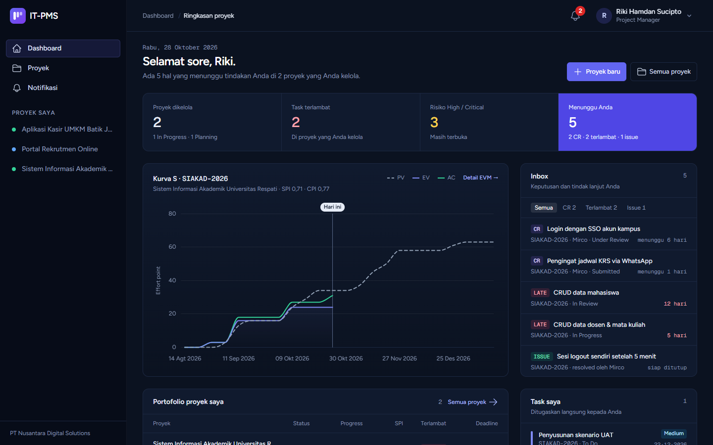
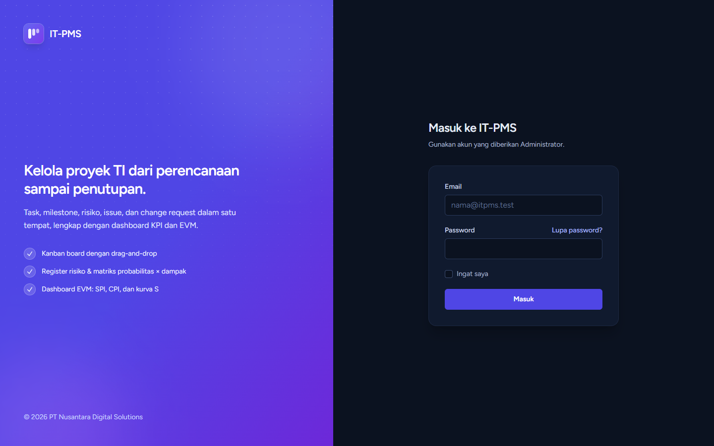
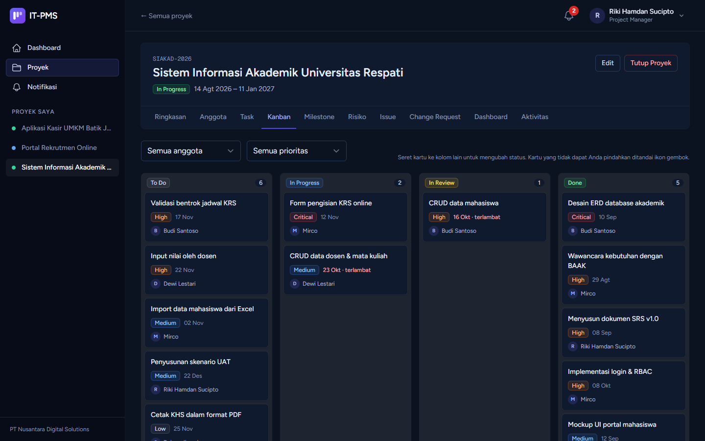
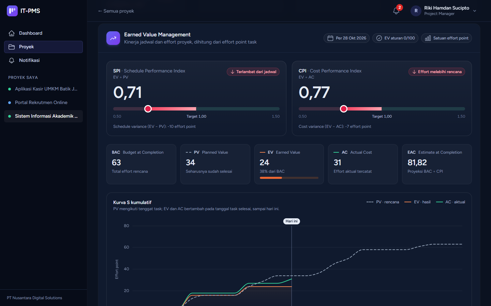
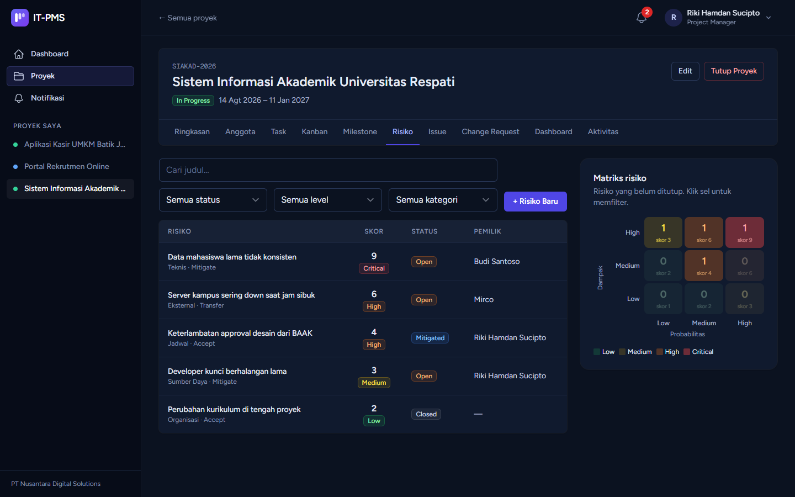

# IT-PMS — IT Project Management System

Aplikasi web manajemen proyek TI untuk **PT Nusantara Digital Solutions (PT NDS)**, software house fiktif di Yogyakarta. Aplikasi ini mencakup perencanaan proyek, task dan milestone, Kanban, register risiko, issue, kolaborasi (komentar & lampiran), dashboard KPI, serta jejak audit lengkap.



| | |
|---|---|
| Kode proyek | IT-PMS-2026-01 |
| Mata kuliah | Manajemen Proyek IT — Teknik Informatika, Universitas Respati Yogyakarta |
| Kelompok | 01 |
| Project Manager | Riki Hamdan Sucipto |
| Anggota tim | Riki Hamdan Sucipto, Mirco |

---

## Daftar isi

1. [Fitur](#fitur)
2. [Tampilan](#tampilan)
3. [Teknologi](#teknologi)
4. [Instalasi (Laragon / Windows)](#instalasi-laragon--windows)
5. [Menjalankan aplikasi](#menjalankan-aplikasi)
6. [Data demo & akun](#data-demo--akun)
7. [Cara EVM dihitung](#cara-evm-dihitung-fr-022)
8. [Peran & hak akses](#peran--hak-akses)
9. [Penjadwal (scheduler)](#penjadwal-scheduler)
10. [Pengujian](#pengujian)
11. [Backup & pemulihan](#backup--pemulihan)
12. [Struktur kode](#struktur-kode)
13. [Checklist produksi](#checklist-produksi)
14. [Konvensi](#konvensi)
15. [Alur kerja Git](#alur-kerja-git)

---

## Fitur

| FR | Modul | Ringkasan | Status |
|---|---|---|---|
| FR-001 / 002 | Autentikasi | Login dengan pesan error generik; akun dikunci 15 menit setelah 5 kali gagal; user non-aktif tidak bisa login; reset password via email; logout & login tercatat | ✅ |
| FR-003 | Manajemen user | CRUD user oleh Admin, pencarian & filter, aktif/nonaktif (bukan hapus) | ✅ |
| FR-004 / 005 | Role & permission | 4 role bawaan, permission `module.action` dapat diubah Admin, role Administrator terkunci | ✅ |
| FR-006 / 007 | Proyek | Buat, ubah, alur status Planning → In Progress ⇄ On Hold, tutup (read-only), buka kembali oleh Admin | ✅ |
| FR-008 | Anggota proyek | Tambah, ubah role, keluarkan (task otomatis unassigned), minimal 1 PM | ✅ |
| FR-009 – 011 | Task | CRUD, filter, alur status To Do → In Progress → In Review → Done dengan konfirmasi | ✅ |
| FR-012 | Milestone | CRUD, saran Completed otomatis, penanda Missed harian | ✅ |
| FR-013 / 014 | Risiko | Skor = probabilitas × dampak otomatis, matriks 3×3, alur Open → Mitigated → Closed | ✅ |
| FR-015 | Issue | Dilaporkan PM/TM, alur Open → In Progress → Resolved → Closed | ✅ |
| FR-016 | Change request | Pengajuan & review perubahan | ✅ |
| FR-017 | Kanban | Drag-and-drop (SortableJS), dropdown status di layar kecil | ✅ |
| FR-018 | Komentar & lampiran | Pada proyek/task/issue; PDF, DOC/X, XLS/X, PNG, JPG, ZIP ≤ 10 MB | ✅ |
| FR-019 | Activity log & notifikasi | Log append-only dengan filter & ekspor CSV; notifikasi in-app dengan badge | ✅ |
| FR-020 | Dashboard KPI | Progress, distribusi task (Chart.js), milestone, task per anggota, ringkasan risiko | ✅ |
| FR-021 | Penutupan proyek | Checklist, catatan penutupan, laporan penutupan otomatis (snapshot) yang bisa dicetak/disimpan sebagai PDF | ✅ |
| FR-022 | Dashboard EVM | PV, EV, AC, SPI, CPI, kurva S, dan interpretasinya dari effort points (rencana) dan effort aktual task | ✅ |

---

## Tampilan

Tangkapan layar diambil dari data `DemoSeeder` pada layar 1440 × 900, dengan tema Midnight Navy.

| | |
|---|---|
| **Halaman masuk**  | **Kanban board**  |
| **Dashboard EVM**  | **Register & matriks risiko**  |

---

## Teknologi

| Komponen | Versi |
|---|---|
| PHP | 8.3 |
| Laravel | 13.x |
| MySQL | 8.4 |
| Node.js | 24 |
| Auth scaffold | Laravel Breeze (Blade) |
| RBAC | spatie/laravel-permission 8 |
| UI | Tailwind CSS 3, Alpine.js |
| Kanban | SortableJS |
| Grafik | Chart.js 4 |
| Build tool | Vite |

---

## Instalasi (Laragon / Windows)

**Prasyarat:** Laragon (PHP 8.3, MySQL 8.4), Composer, dan Node.js 24.

1. **Ambil kode** ke folder `www` Laragon, misalnya `C:\laragon\www\it-pms`, supaya Laragon otomatis membuat alamat `http://it-pms.test`:
   ```bash
   git clone <url-repo> it-pms
   ```

2. **Pasang dependensi:**
   ```bash
   composer install
   npm install
   ```

3. **Siapkan `.env`:**
   ```bash
   copy .env.example .env
   php artisan key:generate
   ```
   Lalu periksa nilai berikut di `.env`:
   ```dotenv
   APP_NAME="IT-PMS"
   APP_URL=http://it-pms.test        # virtual host otomatis Laragon
   APP_LOCALE=id
   APP_TIMEZONE=Asia/Jakarta         # opsional, nilai bawaannya sudah Asia/Jakarta

   DB_CONNECTION=mysql
   DB_HOST=127.0.0.1
   DB_PORT=3306
   DB_DATABASE=it_pms
   DB_USERNAME=root
   DB_PASSWORD=
   ```

4. **Buat database** `it_pms`, misalnya lewat HeidiSQL di Laragon atau perintah berikut:
   ```bash
   mysql -uroot -e "CREATE DATABASE it_pms CHARACTER SET utf8mb4 COLLATE utf8mb4_unicode_ci"
   ```

5. **Migrasi dan isi data:**
   ```bash
   php artisan migrate --seed                  # role, permission & 3 akun dasar
   php artisan db:seed --class=DemoSeeder      # opsional: data demo lengkap
   ```

6. **Build aset front-end:**
   ```bash
   npm run build
   ```

### Email (reset password)

Secara bawaan `MAIL_MAILER=log`, sehingga email reset password ditulis ke `storage/logs/laravel.log`. Untuk benar-benar mengirim email, isi pengaturan SMTP, misalnya Gmail dengan App Password:

```dotenv
MAIL_MAILER=smtp
MAIL_HOST=smtp.gmail.com
MAIL_PORT=587
MAIL_USERNAME=akun@gmail.com
MAIL_PASSWORD=app-password-16-digit
MAIL_FROM_ADDRESS="noreply@itpms.test"
```

---

## Menjalankan aplikasi

**Lewat Laragon (disarankan):** jalankan *Start All*, lalu buka **http://it-pms.test**.

**Lewat server bawaan PHP:**
```bash
php artisan serve           # http://localhost:8000
```

**Mode pengembangan** (Vite hot reload, queue, dan log sekaligus):
```bash
composer run dev
```

Jika muncul error *"Unable to locate file in Vite manifest"*, jalankan `npm run build` atau `npm run dev`.

---

## Data demo & akun

Akun dari `php artisan migrate --seed`:

| Email | Role | Password |
|---|---|---|
| admin@itpms.test | Administrator | `password` |
| riki@itpms.test | Project Manager | `password` |
| mirco@itpms.test | Team Member | `password` |

`DemoSeeder` menambahkan akun dan data berikut:

| Email | Role global |
|---|---|
| sari@itpms.test | Project Manager |
| budi@, dewi@, agus@, rina@itpms.test | Team Member |
| hendra@itpms.test | Viewer (perwakilan klien) |
| yoga@itpms.test | Team Member, **non-aktif** (untuk demo login ditolak) |

| Proyek | Status | Isi |
|---|---|---|
| Sistem Informasi Akademik Universitas Respati (`SIAKAD-2026`) | In Progress | 14 task (ada yang terlambat, dengan effort aktual untuk EVM), 4 milestone, 5 risiko, 4 issue, 4 change request (tiap status), komentar, lampiran, notifikasi |
| Aplikasi Kasir UMKM Batik Jogja (`KASIR-BATIK`) | In Progress | Proyek milik Sari; Riki ikut sebagai Viewer |
| Website Company Profile PT NDS (`WEB-NDS`) | Closed | Contoh proyek yang sudah ditutup (read-only), lengkap dengan laporan penutupan |
| Portal Rekrutmen Online (`REKRUT-2027`) | Planning | Proyek yang belum dimulai |

Semua tanggal dihitung relatif terhadap hari seeder dijalankan, dan activity log disusun mundur sesuai garis waktu proyek. Untuk mengulang data demo dari awal:

```bash
php artisan migrate:fresh --seed
php artisan db:seed --class=DemoSeeder
```

> ⚠️ `migrate:fresh` **menghapus seluruh isi database**. Lakukan backup lebih dulu jika ada data penting.

---

## Cara EVM dihitung (FR-022)

EVM ditampilkan di tab **Dashboard** setiap proyek, dalam satuan *effort point*:

| Metrik | Rumus |
|---|---|
| BAC (Budget at Completion) | Jumlah `effort_points` semua task |
| PV (Planned Value) | Jumlah `effort_points` task yang tenggatnya sudah lewat atau jatuh hari ini |
| EV (Earned Value) | Jumlah `effort_points` task berstatus Done (aturan 0/100) |
| AC (Actual Cost) | Jumlah `actual_effort_points`, diisi PM lewat form task atau oleh assignee di halaman task |
| SPI / CPI | EV ÷ PV / EV ÷ AC; di atas 1 berarti lebih cepat / lebih hemat, di bawah 1 berarti terlambat / boros |

Dashboard menampilkan pesan **"Data belum lengkap"** jika ada task tanpa effort points, task tanpa tenggat, atau task Done yang effort aktualnya belum dicatat.

---

## Peran & hak akses

Setiap user punya **satu role global**, dan **role per proyek** (`project_members.role_in_project`) yang bisa berbeda dari role global. Di dalam sebuah proyek, yang menentukan hak akses adalah role user **di proyek itu**: sistem memeriksa permission milik role Spatie dengan nama yang sama. Akibatnya, perubahan permission di menu *Role & Permission* langsung berlaku di semua proyek. Administrator memakai permission globalnya di proyek mana pun.

| Kemampuan | Administrator | Project Manager | Team Member | Viewer |
|---|:---:|:---:|:---:|:---:|
| Kelola user, role & permission | ✅ | — | — | — |
| Lihat semua proyek / activity log global | ✅ | — | — | — |
| Buat proyek (Admin menunjuk PM-nya; PM yang membuat otomatis menjadi PM) | ✅ | ✅ | — | — |
| Kelola proyek, anggota, task, milestone, risiko | ✅ | ✅ | — | — |
| Ubah status task **miliknya** / pindahkan kartunya di Kanban | ✅ | ✅ | ✅ | — |
| Laporkan issue, ubah status issue miliknya sampai Resolved | ✅ | ✅ | ✅ | — |
| Ajukan change request (Team Member hanya melihat CR miliknya) | ✅ | ✅ | ✅ | — |
| Review change request (Approve/Reject dengan justifikasi) | ✅ | ✅ | — | — |
| Komentar & unggah lampiran | ✅ | ✅ | ✅ | — |
| Lihat proyek, task, risiko, issue, change request, dashboard; unduh lampiran | ✅ | ✅ | ✅ | ✅ |
| Buka kembali proyek yang Closed | ✅ | — | — | — |

Semua aturan diperiksa di server (Policy dan Form Request). Mengakses URL secara langsung tanpa hak akses menghasilkan **403**, dan mengakses data milik proyek lain menghasilkan **404**.

---

## Penjadwal (scheduler)

Command `milestones:mark-missed` menandai milestone yang lewat tanggal target sebagai **Missed**. Command ini dijadwalkan setiap hari pukul 00:05 (lihat `routes/console.php`).

```bash
php artisan schedule:work            # lokal: biarkan berjalan di terminal terpisah
php artisan milestones:mark-missed   # atau jalankan manual
```

Di server production, jalankan `php artisan schedule:run` setiap menit lewat cron atau Windows Task Scheduler.

---

## Pengujian

Test ditulis dengan PHPUnit dan secara bawaan berjalan di SQLite in-memory:

```bash
php artisan test                     # seluruh test
php artisan test --filter=Kanban     # sebagian
```

Untuk menjalankan test terhadap MySQL (sama seperti production), buat database `it_pms_test` sekali, lalu jalankan dari *Terminal* Laragon (cmd):

```bat
set DB_CONNECTION=mysql&& set DB_DATABASE=it_pms_test&& php vendor\bin\phpunit
```

Di Git Bash, macOS, atau Linux:

```bash
DB_CONNECTION=mysql DB_DATABASE=it_pms_test php vendor/bin/phpunit
```

> Database `it_pms_test` dikosongkan setiap kali test dijalankan. Jangan memakai database `it_pms` untuk test.

Format kode diperiksa dengan Laravel Pint:

```bash
vendor/bin/pint
```

---

## Backup & pemulihan

Data aplikasi tersimpan di dua tempat, dan keduanya harus di-backup bersama:

1. **Database** `it_pms`
2. **File lampiran** di `storage/app/attachments/`

### Backup

Jalankan dari *Terminal* Laragon di folder proyek. Ganti `YYYY-MM-DD` dengan tanggal backup, misalnya `2026-10-28`:

```bat
mkdir backup
mysqldump -uroot --single-transaction --routines --triggers it_pms > backup\it_pms_YYYY-MM-DD.sql
tar -czf backup\attachments_YYYY-MM-DD.tar.gz -C storage\app attachments
```

Folder `backup/` sudah masuk `.gitignore`, jadi hasil backup tidak ikut ter-commit.

### Pemulihan

```bat
mysql -uroot -e "CREATE DATABASE IF NOT EXISTS it_pms CHARACTER SET utf8mb4 COLLATE utf8mb4_unicode_ci"
mysql -uroot it_pms < backup\it_pms_YYYY-MM-DD.sql
tar -xzf backup\attachments_YYYY-MM-DD.tar.gz -C storage\app
php artisan optimize:clear
```

Sarannya, backup dilakukan harian dan disimpan di lokasi selain server aplikasi. Uji prosedur pemulihan secara berkala di database terpisah.

---

## Struktur kode

```
app/
├── Console/Commands/        MarkMissedMilestones (scheduler)
├── Enums/                   Status, prioritas & level, beserta aturan transisi alur kerja
├── Http/
│   ├── Controllers/         Satu controller per modul; Admin/ untuk User & Role
│   │   └── Concerns/        ChangesTaskStatus (dipakai halaman Task & Kanban)
│   ├── Middleware/          EnsureUserIsActive
│   └── Requests/            Form Request untuk semua validasi
│       └── Concerns/        ResolvesCollaborationTarget (komentar & lampiran)
├── Models/                  Eloquent model; Concerns/HasCollaboration
├── Notifications/           Notifikasi in-app (database channel)
└── Policies/                Otorisasi per modul
database/
├── migrations/              Setiap migration punya down()
└── seeders/                 RoleSeeder, PermissionSeeder (matrix izin), DemoSeeder
resources/
├── js/                      app.js, kanban.js, charts.js
└── views/                   Blade per modul; errors/ untuk halaman 403/404/419/429/500/503
tests/Feature, tests/Unit    Test per modul
docs/screenshots/            Tangkapan layar untuk README
```

Hal-hal penting dalam implementasi:

- **Activity log** (`ActivityLog::record()`) bersifat append-only: model menolak update dan delete. Nilai `password` dan `remember_token` tidak pernah ikut dicatat.
- **Soft delete** dipakai untuk proyek, task, milestone, risiko, issue, komentar, dan lampiran. User tidak dihapus, melainkan dinonaktifkan.
- **Lampiran** disimpan di disk privat `attachments` dengan nama acak, dan hanya bisa diunduh lewat route yang memeriksa hak akses.

---

## Checklist produksi

```dotenv
APP_ENV=production
APP_DEBUG=false     # wajib: menyembunyikan stack trace (NFR-005); halaman 500 tampil ramah
APP_URL=https://domain-anda
```

```bash
composer install --no-dev --optimize-autoloader
npm run build
php artisan migrate --force
php artisan optimize
```

Selain itu, jalankan scheduler (lihat di atas), atur SMTP, dan jadwalkan backup.

---

## Konvensi

- Kode mengikuti PSR-12 dan diformat dengan Laravel Pint.
- Validasi selalu di **Form Request**, otorisasi selalu di **Policy**, dan setiap operasi CRUD serta perubahan status dicatat di activity log.
- Tampilan memakai tema gelap **Midnight Navy**. Kelas warna terang Tailwind (mis. `bg-white`, `text-gray-500`, `bg-green-50`) dipetakan ke palet gelap oleh `resources/css/night-colors.css`; dasar form dan animasinya ada di `resources/css/night.css`. Jika memakai kelas warna terang baru, tambahkan pemetaannya di sana. Halaman cetak (laporan penutupan) memakai `<x-app-layout theme="light">`.
- Format pesan commit: `[module] action: deskripsi singkat`, contoh:
  ```
  [task] add: alur status dengan konfirmasi Done
  [kanban] fix: kartu kembali ke kolom asal saat ditolak server
  ```

---

## Alur kerja Git

Branch `main` selalu berisi versi yang sudah lolos test. Setiap fitur atau perbaikan dikerjakan di branch sendiri:

```bash
git switch main
git pull                                   # ambil perubahan terbaru dari anggota lain
git switch -c fitur/nama-fitur             # contoh: fitur/export-laporan, fix/filter-risiko
```

Setelah selesai:

```bash
php artisan test                           # pastikan semua test lulus
vendor/bin/pint                            # rapikan format kode
git add -A
git commit -m "[module] action: deskripsi singkat"
git push -u origin fitur/nama-fitur        # lalu buat Pull Request ke main
```

Anggota lain me-review Pull Request sebelum di-merge ke `main`. File `.env`, `vendor/`, `node_modules/`, `public/build/`, dan lampiran di `storage/` tidak pernah di-commit.

---

Dibuat untuk tugas mata kuliah Manajemen Proyek IT, Universitas Respati Yogyakarta.
